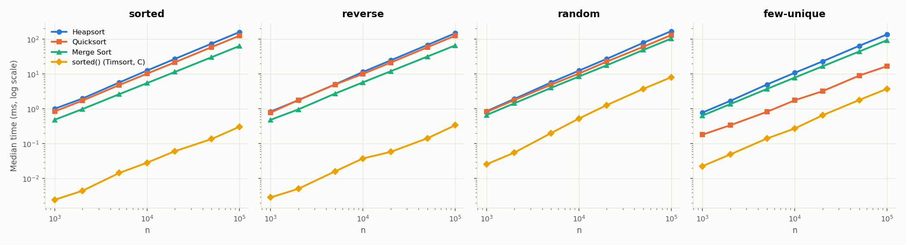
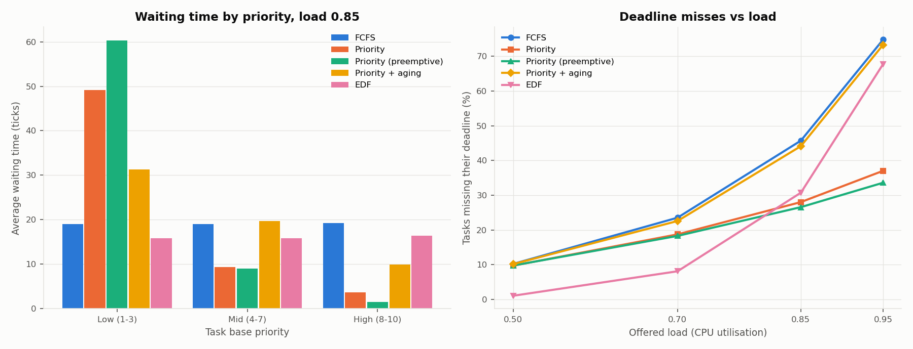

# MSCS532 Assignment 4: Heap Data Structures

This repository contains:

* Heapsort, implemented on an array-based max-heap.
* An empirical comparison of Heapsort with Quicksort and Merge Sort.
* A binary-heap priority queue of `Task` objects.
* A CPU scheduler simulation that uses the priority queue to compare five scheduling
  policies.

The algorithms follow *Introduction to Algorithms* (Cormen et al., 4th ed., ch. 6). The full
write-up, covering design choices, complexity proofs and discussion of results, is in
**[REPORT.md](REPORT.md)**.

| File | Contents |
|---|---|
| `heapsort.py` | `heapify`, `build_heap`, `heap_sort` (in place), `heap_sorted` |
| `sorts.py` | Randomized three-way Quicksort and top-down Merge Sort (baselines) |
| `priority_queue.py` | `Task` dataclass and `HeapPriorityQueue`: `insert`, `extract_max`/`extract_min`, `increase_key`, `decrease_key`, `is_empty`, `peek`, `remove` |
| `scheduler.py` | Tick-based single-CPU scheduler: FCFS, Priority, Priority (preemptive), Priority + aging, EDF |
| `run_benchmarks.py` | Sorting times, comparison counts, and priority-queue operation timings |
| `test_heaps.py` | 25 unit tests covering all of the above |
| `chart_style.py` | Shared graph styling |
| `results/` | CSV data, graphs and terminal output from the last full run |

## Requirements

You need Python 3.8 or later. The algorithms and tests use only the standard library. The
graphs need `matplotlib`:

```bash
pip install matplotlib
```

## Running the code

```bash
python3 -m unittest -v test_heaps
```

```bash
python3 heapsort.py
```

```bash
python3 priority_queue.py
```

```bash
python3 scheduler.py
```

```bash
python3 run_benchmarks.py
```

* `python3 heapsort.py` shows a small heapsort demo.
* `python3 priority_queue.py` demonstrates insert, increase_key, decrease_key and
  extract_max.
* `python3 scheduler.py` prints a demo trace, then runs the full experiment (about 2
  seconds).
* `python3 run_benchmarks.py` runs the full sorting and priority-queue benchmark (about 1–2
  minutes).

Both `scheduler.py` and `run_benchmarks.py` accept `--quick` for a smaller run. Results go to
`results/`.

## Summary of findings

### Heapsort

| Case | Time | Note |
|---|---|---|
| Worst | Θ(n lg n) | O(n) build + n−1 sift-downs of O(lg n) |
| Average | Θ(n lg n) | Comparison-sort lower bound lg n! = Ω(n lg n) |
| Best (distinct keys) | Θ(n lg n) | Every extraction sinks a leaf element through about lg n levels, whatever the input order |
| Best (all keys equal) | Θ(n) | Sift-down stops immediately: exactly 3n comparisons |
| Extra space | O(1) | In place, iterative heapify, no recursion. Not stable. |

Measured at n = 100,000, median of 5 runs (ms):

| | sorted | reverse | random | few-unique |
|---|---|---|---|---|
| Heapsort | 157.8 | 146.8 | 167.7 | 135.6 |
| Quicksort (random pivot, 3-way) | 123.8 | 125.0 | 129.2 | 16.7 |
| Merge Sort | 63.0 | 65.7 | 102.6 | 92.5 |

* **All three scale as n lg n.** Doubling n multiplies time by about 2.14, against 2.13
  predicted.
* **Heapsort is the most input-insensitive.** Its comparison count stays between 1.65 and
  1.85 n lg n on every input.
* **Heapsort is also the slowest by a constant factor.** It makes about 2× the comparisons
  of Merge Sort and has poor cache locality.
* **Heapsort's strength is a guaranteed O(n lg n) worst case with O(1) extra space.**



### Priority queue

The priority queue is an array-backed binary heap plus a `task_id → index` map. With the
map, `increase_key` and `decrease_key` find the task in O(1) and then sift it in O(lg n).

| Operation | Time |
|---|---|
| `insert` | O(lg n) worst case; measured about O(1) average for random keys |
| `extract_max` / `extract_min` | O(lg n) |
| `increase_key` / `decrease_key` | O(lg n) |
| `is_empty`, `peek` | O(1) |

### Scheduler (2,000 tasks × 5 seeds, load 0.85)

| Policy | avg wait | max wait | wait, prio 8–10 | wait, prio 1–3 | missed deadlines |
|---|---|---|---|---|---|
| FCFS | 19.1 | 107 | 19.3 | 19.0 | 45.7% |
| Priority (preemptive) | 21.8 | 724 | 1.4 | 60.4 | 26.6% |
| Priority + aging | 20.2 | 127 | 9.9 | 31.3 | 44.1% |
| EDF | 16.0 | 114 | 16.4 | 15.8 | 30.7% |

* **Priority scheduling serves urgent tasks almost immediately but starves low-priority
  ones.** At load 0.95 the worst wait reaches 2,110 ticks.
* **Aging with `increase_key` cuts that worst wait to 223.**
* **EDF misses the fewest deadlines below saturation.** At load 0.5 it misses 1.1%, against
  about 10% for the other policies. It degrades sharply once the system is overloaded.


