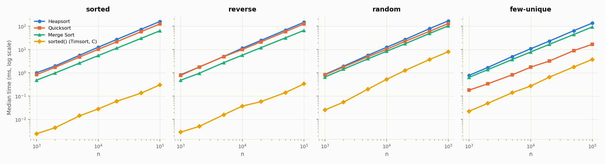
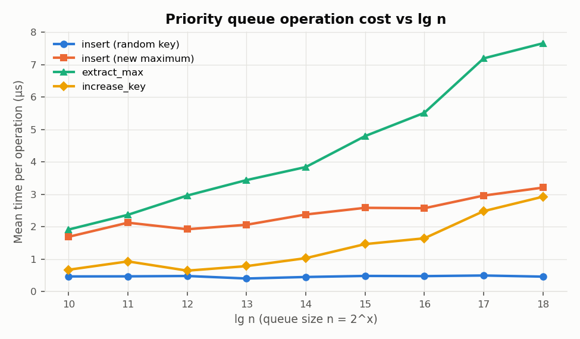
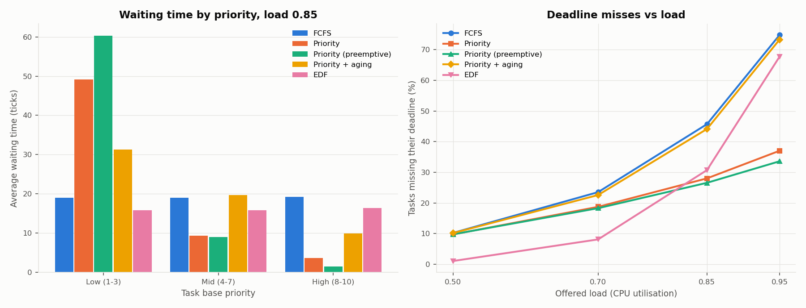

# Heap Data Structures: Implementation, Analysis, and Applications

MSCS532 Assignment 4

All measurements were taken with Python 3.13.9 on an Apple Silicon Mac. Every number
quoted below comes from [`results/benchmark_output.txt`](results/benchmark_output.txt)
and [`results/scheduler_output.txt`](results/scheduler_output.txt), which the scripts in
this repository regenerate.

## Contents

1. [Heapsort implementation](#1-heapsort-implementation)
2. [Heapsort analysis](#2-heapsort-analysis)
3. [Empirical comparison with Quicksort and Merge Sort](#3-empirical-comparison-with-quicksort-and-merge-sort)
4. [Priority queue design](#4-priority-queue-design)
5. [Priority queue operations and their complexity](#5-priority-queue-operations-and-their-complexity)
6. [Scheduler simulation](#6-scheduler-simulation)
7. [Conclusions](#7-conclusions)
8. [References](#8-references)

---

## 1. Heapsort implementation

File: [`heapsort.py`](heapsort.py). The code follows HEAPSORT, BUILD-MAX-HEAP and MAX-HEAPIFY
from Cormen et al. (2022, ch. 6), translated to 0-based indices:

```
parent(i) = (i - 1) // 2      left(i) = 2i + 1      right(i) = 2i + 2
```

A max-heap is a list in which `A[parent(i)] >= A[i]` for every `i > 0`, so the maximum is
always at `A[0]`. The list is read as a complete binary tree, filled level by level from the
left, so the tree has height ⌊lg n⌋.

The algorithm has three parts.

| Function | What it does |
|---|---|
| `heapify(arr, root, size)` | Assumes both subtrees of `root` are heaps. Swaps `arr[root]` with its larger child until neither child is larger. |
| `build_heap(arr)` | Calls `heapify` on the internal nodes `n//2 - 1` down to `0`. Nodes `n//2` and above are leaves, which are already one-element heaps. |
| `heap_sort(arr)` | Builds the heap. Then, for `last = n-1` down to `1`, swaps the maximum `arr[0]` into `arr[last]`, shrinks the heap to `arr[0:last]`, and re-heapifies the root. |

The heap and the sorted output share the same list. The heap occupies the prefix and the
sorted suffix grows from the right, so the sort is in place.

Implementation choices:

* **Iterative `heapify`.** CLRS writes MAX-HEAPIFY as a tail-recursive procedure. A
  `while` loop does the same thing without a Python function call per level, and the code
  never needs a call stack deeper than one frame.
* **Only `<` is used.** Any mutually comparable values can be sorted: ints, floats,
  strings, tuples, or objects that define `__lt__`. This also let the benchmark count
  comparisons by wrapping values in a class whose `__lt__` increments a counter.
* **`heap_sorted(values)`** is a convenience wrapper that copies its input first, like
  the built-in `sorted()`.

## 2. Heapsort analysis

### 2.1 MAX-HEAPIFY: O(h)

Each pass of the loop compares a node with at most two children, does at most one swap,
and moves exactly one level down. A node of height h therefore costs at most h passes,
with 2 comparisons and 1 swap each, which is O(h). The root has height ⌊lg n⌋, so a call at
the root is O(lg n).

### 2.2 BUILD-MAX-HEAP: O(n), not O(n lg n)

A naive bound is n/2 calls times O(lg n) = O(n lg n). The bound is loose because most nodes
are near the bottom of the tree. An n-element heap has at most ⌈n / 2^(h+1)⌉ nodes of
height h, and heapifying one of them costs O(h). Summing over all heights:

$$
\sum_{h=0}^{\lfloor \lg n \rfloor} \left\lceil \frac{n}{2^{h+1}} \right\rceil O(h)
\;=\; O\!\left(n \sum_{h=0}^{\infty} \frac{h}{2^{h}}\right)
\;=\; O(n \cdot 2) \;=\; O(n).
$$

The series $\sum h/2^h$ converges to 2. Half the nodes are leaves and cost nothing, a
quarter cost at most one level, and so on.

### 2.3 Extraction phase: O(n lg n)

The loop runs n − 1 times. Each iteration does one swap in O(1) and one `heapify(arr, 0,
last)` on a heap of `last` elements, which costs O(lg last) ≤ O(lg n). The total is

$$
\sum_{k=2}^{n} O(\lg k) \;=\; O(\lg n!) \;=\; O(n \lg n),
$$

because lg n! = Θ(n lg n) by Stirling's approximation.

### 2.4 Worst, average and best case

| Case | Bound | Reason |
|---|---|---|
| **Worst** | **Θ(n lg n)** | The upper bound is O(n) + O(n lg n) from §2.2–2.3. The lower bound holds for any comparison sort: a decision tree with n! leaves has height at least lg n! = Ω(n lg n). |
| **Average** | **Θ(n lg n)** | It cannot exceed the worst case. The decision-tree argument also bounds the average: a binary tree with n! leaves has average leaf depth at least lg n!. So no comparison sort averages better than Ω(n lg n). |
| **Best, distinct keys** | **Θ(n lg n)** | See below. |
| **Best, all keys equal** | **Θ(n)** | Every `heapify` call stops after its first two comparisons, because no child is *strictly* larger. This gives exactly 3n comparisons, measured: 59,994 for n = 20,000. |

**Why the time is n lg n even on "easy" input.** For most sorting algorithms, input order
changes the running time. Insertion sort is Θ(n) on sorted input. Quicksort with a fixed
pivot is Θ(n²) on sorted input. Heapsort is unusual because the input order can only affect
the build phase, which is O(n) in every case. The extraction phase always behaves the same
way:

1. The element swapped into the root is `arr[last]`, the last leaf of the current heap.
2. A leaf of a max-heap tends to be one of the smallest elements present. Every one of its
   ancestors must be at least as large, so it is a poor candidate for the root.
3. That small element therefore sinks most of the way back down: about lg n levels, with
   2 comparisons per level.

The extraction phase destroys whatever order the input had and rebuilds it one level at a
time, so its cost depends on the heap's height and not on the input order. Schaffer and
Sedgewick (1993) made this rigorous. Even the best-case arrangement of distinct keys needs
about ½·n lg n comparisons, and the average and worst cases need about 2n lg n. So for
distinct keys heapsort is Θ(n lg n) in **all** cases. The only way to escape the bound is
heavy duplication, which lets sift-down stop early, as the all-equal row shows.

Part 2 of the benchmark checks this. It counted the key comparisons on 20,000 elements:

| Comparisons / (n lg n) | sorted | reverse | random | few-unique (10 values) |
|---|---|---|---|---|
| **Heapsort** | 1.85 | 1.73 | 1.79 | 1.65 |
| Quicksort (random pivot, 3-way) | 1.79 | 1.73 | 1.86 | 0.32 |
| Merge Sort | 0.49 | 0.52 | 0.91 | 0.88 |

Heapsort's count varies by only 12% across four very different inputs, and sits just under
the 2n lg n predicted for the average case. The other two algorithms adapt to their input.
Merge Sort halves its comparisons on presorted data, and three-way Quicksort skips most of
the work on duplicate-heavy data. Heapsort barely adapts.

Sorted input is in fact heapsort's slowest case. Ascending order is the opposite of a
max-heap, so BUILD-MAX-HEAP does the most swaps. Reverse-sorted input is already a max-heap,
so the build phase is just comparisons.

### 2.5 Space complexity and overheads

* **Auxiliary space: O(1).** The sort rearranges the input list and uses only a few index
  variables. Because `heapify` is iterative, there is no recursion stack. The recursive
  CLRS version would use O(lg n) stack frames.
* **Not stable.** The long-distance swaps (root ↔ last leaf) can reorder equal keys.
  Sorting `[(2,'b'), (2,'a')]` by first field does not guarantee `'b'` stays first.
* **Poor locality of reference.** The children of `i` are at `2i+1` and `2i+2`, so each
  level of a sift-down jumps about twice as far through memory as the last. Near the bottom
  of a large heap every step is a likely cache miss. Merge Sort and Quicksort scan memory
  sequentially. This is the main reason heapsort is usually slower in practice despite the
  same asymptotic bound. Time per n lg n grew about 19% from n = 10³ (85 ns) to n = 10⁵
  (101 ns). Interpreter overhead hides much of the cache effect in Python, but not all of it.
* **About 2 comparisons per level.** Each sift-down step compares the two children with
  each other and with the parent. Floyd's "bottom-up" heapsort variant sinks to a leaf
  first and then climbs back up, which cuts this to about n lg n comparisons. It was not
  used here, to keep the code close to the textbook.

## 3. Empirical comparison with Quicksort and Merge Sort

File: [`run_benchmarks.py`](run_benchmarks.py). Baselines are in [`sorts.py`](sorts.py).

**Setup.**

* *Quicksort* uses a random pivot with three-way partitioning (`<`, `==`, `>`), recursing
  on the smaller side.
* *Merge Sort* is top-down and returns a new list.
* Python's built-in `sorted()` (Timsort, written in C) is timed as a reference only.
* Sizes: n = 1,000 to 100,000.
* Four input distributions: sorted, reverse-sorted, uniformly random, and few-unique
  (random values 0–9).
* Each time is the median of 5 runs on a fresh copy of the input. Every result is checked
  against `sorted()`.



*Figure 1. Median running time on log-log axes, one panel per input distribution.*

Running time at n = 100,000 (ms):

| | sorted | reverse | random | few-unique |
|---|---|---|---|---|
| **Heapsort** | 157.8 | 146.8 | 167.7 | 135.6 |
| Quicksort | 123.8 | 125.0 | 129.2 | 16.7 |
| Merge Sort | 63.0 | 65.7 | 102.6 | 92.5 |
| sorted() (C) | 0.3 | 0.3 | 8.0 | 3.7 |

### Discussion

**All three grow as n lg n.** On the log-log plot the Heapsort, Quicksort and Merge Sort
lines are straight and parallel, with slope just over 1. Going from n = 50,000 to 100,000,
Heapsort on random data went from 78.2 ms to 167.7 ms, a factor of 2.14. The n lg n model
predicts (100000·lg 100000)/(50000·lg 50000) = 2.13. Nothing behaves quadratically.

**Heapsort is the most input-insensitive.** Across the four distributions its times differ
by at most a factor of 1.24 (135.6 to 167.7 ms), which matches the flat comparison counts
in §2.4. Few-unique input is a little faster because ties stop sift-down early. Sorted input
is a little slower because the build phase does the most swaps.

**Heapsort is the slowest of the three by a constant factor.** On random data it takes 1.3×
as long as Quicksort and 1.6× as long as Merge Sort. On sorted data it takes 2.5× as long as
Merge Sort. This does not contradict the theory, since all three are Θ(n lg n) and differ
only in constants:

* Heapsort makes about 1.8 n lg n comparisons. Merge Sort makes about 0.9 n lg n on random
  data and about 0.5 n lg n on sorted data, where each merge exhausts one side early.
* Merge Sort's copying is done by list slicing and `list.extend`, which run in C. Each step
  of heapsort is several Python bytecodes for index arithmetic and tuple swaps.
* As noted in §2.5, heapsort's memory access pattern is the least cache-friendly.

**Quicksort is fast because of its design choices.** The random pivot makes sorted and
reverse-sorted input look random, so all three take about 125 ms. A fixed last-element
pivot would be Θ(n²) on them. In Assignment 2 that version took 1,048 ms on just 8,000
sorted elements. Three-way partitioning puts every key equal to the pivot in its final place
in one pass. With only 10 distinct values the recursion depth is bounded by about 10, so
few-unique input sorts 8× faster than random. Quicksort's Θ(n²) worst case still exists, but
only with vanishing probability.

**Merge Sort is adaptive in comparisons but not in time complexity.** Sorted input halves
its comparisons, because every merge takes all of the left half first. The algorithm still
does the full Θ(n lg n) of copying, so it is faster on sorted data without changing class.

**The C reference.** `sorted()` is 16–500× faster than any of the Python implementations.
Part of that is C versus interpreted Python. Part of it is that Timsort detects existing
runs, which makes it Θ(n) on sorted and reverse-sorted input; that is visible as the much
lower curves in the first two panels.

**When heapsort is the right choice.** Heapsort is never the fastest here, but it is the
only one of the three with *all* of these properties:

* a guaranteed O(n lg n) worst case (unlike Quicksort);
* O(1) extra space (unlike Merge Sort's Θ(n));
* no recursion.

That is why production introsort, used in C++'s `std::sort`, runs Quicksort but switches to
heapsort when recursion gets too deep. It is also why heapsort suits memory-constrained or
real-time code, where a predictable bound matters more than average speed.

## 4. Priority queue design

File: [`priority_queue.py`](priority_queue.py).

### 4.1 Array (Python list) representation

The heap is stored in one Python list, using the same index arithmetic as heapsort. I chose
a list over a linked tree of node objects for these reasons:

* **Parent and child are found by arithmetic in O(1).** A linked tree needs three pointers
  per node (left, right and parent, since sift-up must climb).
* **Insert and extract only touch the end of the array.** A new element goes into the first
  free leaf, `list.append`, which is amortized O(1). Extract moves the last leaf to the root
  and calls `list.pop()`, which is O(1). A linked tree would need an O(lg n) walk, using the
  binary representation of n, just to find the "last" position.
* **The tree is always complete.** Its height is exactly ⌊lg n⌋ and no space is wasted on
  missing children.
* **Memory is compact.** A Python list is a contiguous array of references, so there is no
  per-node object or pointer overhead.
* **The code is simpler and shared.** The bubble-down loop is the same idea as heapsort's
  `heapify`.

The one thing an array does not provide is finding an arbitrary task. That is solved with a
position map, described in §4.3.

### 4.2 The `Task` class

`Task` is a `dataclass`.

| Field | Meaning |
|---|---|
| `task_id` | Unique ID. Used as the key in the position map. |
| `priority` | Larger means more urgent (1–10 in the simulation). Aging may raise it. |
| `arrival` | The tick at which the task becomes ready. |
| `duration` | The number of CPU ticks the task needs. |
| `deadline` | The tick by which it should finish, or `None` for no deadline. |
| `label` | An optional name for printing. |
| `original_priority`, `time_left`, `started_at`, `finished_at` | Bookkeeping filled in by the scheduler. |

Derived properties are `wait_time`, `turnaround_time`, `response_time` and `is_late`. The class
uses `eq=False` so that two tasks with equal fields are still separate objects.

### 4.3 Entries, ties and the position map

* Each heap slot holds `[key, order, task]`.
  * `key` is a cached copy of the attribute the queue is ordered on. Comparisons therefore
    avoid a `getattr` call.
  * `order` is an insertion counter. Tasks with equal keys are served in FIFO order, which is
    fair and makes the simulation deterministic.
* `where` is a dictionary from `task_id` to the task's index in the list.
  * It is updated inside `_swap`, at O(1) per swap.
  * Without it, `increase_key(task, …)` would first have to find the task with an O(n)
    linear scan. With it, the lookup is O(1) and the whole operation is O(lg n).
  * Cost: Θ(n) extra memory, and a small constant extra per swap.

### 4.4 Max-heap or min-heap?

The class `HeapPriorityQueue` takes `kind="max"` or `kind="min"` and a `key` attribute name.
One comparison helper, `_goes_first(x, y)`, encodes the order, so the bubble-up and
bubble-down code is shared.

* **Priority scheduling uses a max-heap on `priority`.** A larger number means more urgent,
  so the most urgent task should be at the root and `extract_max` should return it. This is
  the main configuration and the one the assignment's `increase_key` refers to (CLRS
  HEAP-INCREASE-KEY).
* **Earliest-Deadline-First uses a min-heap on `deadline`.** The smallest deadline is the
  most urgent.
* **FCFS uses a min-heap on `arrival`.** It serves as the baseline.

Supporting both orders let the simulation compare five policies with a single data
structure.

## 5. Priority queue operations and their complexity

Let n be the number of queued tasks. The tree is complete, so its height is ⌊lg n⌋. Every
path from a leaf to the root, or from the root to a leaf, has at most ⌊lg n⌋ edges.

| Operation | Time | How |
|---|---|---|
| `insert(task)` | **O(lg n)** | Append to the first free leaf (amortized O(1)). Then *sift up*: while the new entry outranks its parent, swap them. One swap per level gives at most ⌊lg n⌋ swaps. |
| `extract_max()` / `extract_min()` | **O(lg n)** | Swap the root with the last leaf and `pop()` the old root in O(1). Then *sift down* from the root: compare with both children, swap with the better one. At most ⌊lg n⌋ levels with 2 comparisons each. |
| `increase_key(task, k)` | **O(lg n)** | Find the slot through `where` in O(1) and overwrite the key. In a max-heap a larger key can only break the heap property with the parent, so sift up, at most ⌊lg n⌋ swaps. In a min-heap a larger key means less urgent, so sift down. It raises `ValueError` if `k` is smaller than the current key, as in CLRS. |
| `decrease_key(task, k)` | **O(lg n)** | The mirror image. Sift down in a max-heap, sift up in a min-heap. |
| `is_empty()` | **O(1)** | `not self._heap` |
| `peek()` | **O(1)** | Returns the root `_heap[0]`. |
| `remove(task)` | **O(lg n)** | Swap the task with the last leaf, pop it, then sift the moved entry up *or* down. Only one of the two will move it. |
| Bulk build (`HeapPriorityQueue(tasks=…)`) | **O(n)** | Bottom-up, the same argument as BUILD-MAX-HEAP in §2.2. |
| Space | **Θ(n)** | The list plus the position map. |

**Correctness of key changes.** In a max-heap, take a node whose key increases. Everything
below it was ≤ its old key, so it is still ≤ the new key, and the subtree stays valid. Only
the edge to the parent can now be violated. Sift-up repairs that edge and moves the problem
one level higher at each step, finishing at the root at the latest. Decreasing a key is
symmetric: only the edges to the children can break, and sift-down repairs them. The same
reasoning, with the order flipped, covers the min-heap.

**Testing.** [`test_heaps.py`](test_heaps.py) has 25 unit tests. One of them runs
3,000 random inserts, key changes, removals and extracts. After every `extract_max` it
checks the result against the maximum of a plain reference list. `validate()`
verifies the heap property and that every `where` entry agrees with the list.

**Empirical check.** Part 3 of the benchmark timed each operation on queues of 2¹⁰ to 2¹⁸
tasks, with the garbage collector paused.



*Figure 2. Mean time per operation against lg n.*

| n | 2¹⁰ | 2¹² | 2¹⁴ | 2¹⁶ | 2¹⁸ |
|---|---|---|---|---|---|
| insert, random key (µs) | 0.46 | 0.48 | 0.45 | 0.47 | 0.46 |
| insert, new maximum (µs) | 1.69 | 1.92 | 2.38 | 2.57 | 3.21 |
| extract_max (µs) | 1.91 | 2.96 | 3.84 | 5.51 | 7.66 |
| increase_key (µs) | 0.67 | 0.64 | 1.03 | 1.64 | 2.93 |

* **extract_max** grows steadily with lg n, as expected. Every extraction sinks a leaf
  element from the root almost back to the bottom. It grows somewhat faster than linearly
  in lg n at the largest sizes, because the heap no longer fits in cache.
* **Insert with a key larger than everything queued** is the true worst case. Every insert
  climbs all ⌊lg n⌋ levels to the root, and its cost rises with lg n.
* **Insert with a random key is flat at about 0.47 µs.** This is a known average-case
  result: in a heap of random keys a new random key sifts up only about 1.6 levels on
  average, whatever the value of n (Porter & Simon, 1975). The O(lg n) bound is a worst
  case, and random insertion rarely gets close to it.
* **increase_key** with a random bump lands somewhere in the middle and grows with lg n.

## 6. Scheduler simulation

File: [`scheduler.py`](scheduler.py).

### 6.1 Model

A single CPU runs in integer ticks. On each tick the scheduler does five things, each
mapped to a priority queue operation:

1. **Admit arrivals.** Each task whose `arrival` time has been reached is added with
   `insert`.
2. **Age waiting tasks** (aging policy only). Every 5 ticks, each waiting task gets
   `increase_key(task, priority + 1)`.
3. **Preempt** (preemptive policies only). If `peek()` shows a waiting task that is
   strictly more urgent than the running one, the running task is put back with `insert`.
4. **Dispatch.** If the CPU is free, `extract_max` (or `extract_min`) chooses the next task.
5. **Run.** The current task runs for one tick. When it finishes, its finish time is
   recorded. If no task is ready, the clock jumps to the next arrival.

Five policies share this one loop and differ only in heap order, key, preemption and aging:

| Policy | Heap | Key | Preemptive | Aging |
|---|---|---|---|---|
| FCFS | min | arrival | no | no |
| Priority | max | priority | no | no |
| Priority (preemptive) | max | priority | yes | no |
| Priority + aging | max | priority | yes | +1 per 5 ticks waited |
| EDF | min | deadline | yes | no |

**Workload.**

* Poisson arrivals.
* Burst time uniform on 1–10 ticks (mean 5.5).
* Priority uniform on 1–10.
* Deadline = arrival + burst × U(2, 6), so each task gets 2–6 times its burst time of slack.
* Offered load ρ (mean burst ÷ mean inter-arrival time) of 0.5, 0.7, 0.85 and 0.95.
* 2,000 tasks per run, averaged over 5 random seeds.

### 6.2 A small worked example

Six hand-made tasks, one letter per tick (aging interval 3 in this demo):

```
  task  prio  arrival  burst  deadline
     A     2        0      6        20
     B     5        1      3         8
     C     9        2      2         6
     D     5        3      4        18
     E     1        4      2         9
     F     8        6      3        12
                         01234567890123456789
  FCFS                   AAAAAABBBCCDDDDEEFFF  avg wait  7.0  missed: B,C,E,F
  Priority               AAAAAACCFFFBBBDDDDEE  avg wait  6.8  missed: B,C,E
  Priority (preemptive)  ABCCBBFFFDDDDAAAAAEE  avg wait  5.7  missed: E
  Priority + aging       ABCCBBFFFDDDDAAAAAEE  avg wait  5.7  missed: E
  EDF                    ABCCBBEEFFFDDDDAAAAA  avg wait  4.7  missed: -
```

* Non-preemptive policies let the long, low-priority task A block everything for 6 ticks.
* Preemption lets B and then C cut in as soon as they arrive.
* EDF is the only policy that meets every deadline. It runs E (priority 1, deadline 9)
  before F (priority 8, deadline 12) because E's deadline is sooner.

### 6.3 Results



*Figure 3. Left: average waiting time by base-priority band at load 0.85. Right: the share
of tasks that miss their deadline, as load rises.*

Load 0.85 (waiting times in ticks):

| Policy | avg wait | p95 wait | max wait | wait, prio 1–3 | wait, prio 8–10 | missed deadline |
|---|---|---|---|---|---|---|
| FCFS | 19.1 | 63 | 107 | 19.0 | 19.3 | 45.7% |
| Priority | 19.4 | 89 | 541 | 49.2 | 3.6 | 28.0% |
| Priority (preemptive) | 21.8 | 103 | 724 | 60.4 | 1.4 | 26.6% |
| Priority + aging | 20.2 | 69 | 127 | 31.3 | 9.9 | 44.1% |
| EDF | 16.0 | 61 | 114 | 15.8 | 16.4 | 30.7% |

Load 0.95:

| Policy | avg wait | max wait | wait, prio 1–3 | wait, prio 8–10 | missed deadline |
|---|---|---|---|---|---|
| FCFS | 57.5 | 203 | 58.1 | 57.1 | 74.8% |
| Priority | 58.7 | 1417 | 177.6 | 4.2 | 37.0% |
| Priority (preemptive) | 66.1 | 2110 | 206.4 | 1.7 | 33.6% |
| Priority + aging | 58.8 | 223 | 74.6 | 43.6 | 73.3% |
| EDF | 52.8 | 215 | 53.2 | 52.5 | 67.7% |

The full table for all four loads is in [`results/scheduler_results.csv`](results/scheduler_results.csv).

### 6.4 Analysis

**Priority scheduling works as designed, and causes starvation.** At load 0.85, preemptive
priority scheduling gives priority 8–10 tasks an average wait of 1.4 ticks, versus 19.3
under FCFS. The cost lands on priority 1–3 tasks: their average wait rises to 60 and the
worst wait reaches 724 ticks. At load 0.95 the worst wait is 2,110 ticks, roughly 380 times
a mean burst. Low-priority tasks are not lost, but they can be postponed almost
indefinitely while higher-priority work keeps arriving. This is the classic starvation
problem.

**Aging bounds starvation.** Raising a waiting task's priority by 1 every 5 ticks means a
priority-1 task overtakes freshly arrived priority-10 work after about 50 ticks of waiting.
With aging, the worst wait at load 0.95 falls from 2,110 to 223 ticks (9.5× lower), and the
p95 at load 0.85 falls from 103 to 69. The trade-off is clear in Figure 3: high-priority
tasks now wait 9.9 ticks instead of 1.4, and the policy moves toward FCFS's fairness, with
deadline misses rising to match. The aging interval is the knob that sets this trade-off.
A short interval approaches FCFS and a long one approaches pure priority.

**Mean waiting time barely changes between non-preemptive policies.** FCFS averages 19.1
ticks and non-preemptive Priority 19.4. Priority only changes *who* waits, not how much
waiting there is in total. This is an instance of Kleinrock's conservation law: in this
workload burst times are independent of priority, and reordering work-conserving service
does not change the total. Preemption adds some overhead (21.8), because a preempted task
holds partly finished work in the queue for longer. EDF has the lowest average (16.0) at
this load.

**EDF is best when the system is not overloaded.** At load 0.5, EDF misses 1.1% of
deadlines; every other policy misses about 10%. At load 0.7 the figures are 8.1% versus
18–24%. This matches theory: on one preemptive processor, EDF meets every deadline whenever
any schedule could (Dertouzos, 1974; Liu & Layland, 1973). As load approaches 1, EDF degrades sharply, to
67.7% missed at load 0.95. That is EDF's known *domino effect*. Once the system is
overloaded, EDF keeps working on tasks that are already going to be late, and they make
the next tasks late too. Priority scheduling degrades more gracefully under overload (37%
missed). It sacrifices a fixed group, the low-priority tasks, and lets the rest finish on
time. A production real-time system usually adds admission control or switches policy
under overload.

**Cost of the heap operations.** One run of 2,000 tasks performs about 2,000 inserts and
2,000 extracts, plus about 2 queue operations per preemption. Each is O(lg m), where m is
the current queue length (typically under 100 here). Aging is the most expensive part:
every 5 ticks it calls `increase_key` on each of the m waiting tasks, which is O(m lg m)
per aging tick. All waiting tasks age at the same rate, so their relative order never
changes, and each of those calls does no swaps. An optimization therefore follows. For a
task that entered the queue at time t₀, the order by `priority + (now − t₀)/5` is the same
as the order by the time-independent key `5·priority − t₀`. With that static key, aging
costs nothing per tick. I kept the explicit `increase_key` loop because it exercises the
required operation and is easier to follow.

## 7. Conclusions

* Heapsort is Θ(n lg n) in the worst and average case, and in the best case for distinct
  keys. The input order only affects the O(n) build phase. The extraction phase always
  sinks a leaf through about lg n levels. Measured comparison counts varied by only 12%
  across sorted, reverse-sorted, random and duplicate-heavy input. The one exception is
  heavily repeated keys: all-equal input is Θ(n) (3n comparisons).
* In wall-clock time heapsort was the slowest of the three O(n lg n) sorts: 1.3× Quicksort
  and 1.6–2.5× Merge Sort. The causes are more comparisons per element and poor cache
  locality. Its strengths are a guaranteed worst case and O(1) extra space.
* An array-backed binary heap with a position map supports `insert`, `extract`,
  `increase_key` and `decrease_key` in O(lg n), and `is_empty`/`peek` in O(1). The timings
  confirm the logarithmic growth.
* In the scheduler, a max-heap priority queue delivers the intended behaviour: urgent tasks
  wait about 1 tick. Without aging it starves low-priority work. `increase_key`-based aging
  bounds that starvation at a modest cost to urgent tasks. A min-heap on deadlines (EDF)
  minimises deadline misses until the system approaches saturation.

## 8. References

* Cormen, T. H., Leiserson, C. E., Rivest, R. L., & Stein, C. (2022). *Introduction to
  Algorithms* (4th ed.). MIT Press. Chapter 6 (Heapsort), Chapter 7 (Quicksort), §2.3
  (Merge Sort), §8.1 (lower bounds for sorting).
* Schaffer, R., & Sedgewick, R. (1993). The analysis of heapsort. *Journal of Algorithms,
  15*(1), 76–100.
* Porter, T., & Simon, I. (1975). Random insertion into a priority queue structure. *IEEE
  Transactions on Software Engineering, SE-1*(3), 292–298.
* Liu, C. L., & Layland, J. W. (1973). Scheduling algorithms for multiprogramming in a
  hard-real-time environment. *Journal of the ACM, 20*(1), 46–61.
* Dertouzos, M. L. (1974). Control robotics: The procedural control of physical
  processes. *Proceedings of IFIP Congress 1974*, 807–813.
* Kleinrock, L. (1976). *Queueing Systems, Volume II: Computer Applications*. Wiley.
* Silberschatz, A., Galvin, P. B., & Gagne, G. (2018). *Operating System Concepts* (10th
  ed.). Wiley. Chapter 5 (CPU scheduling, aging).
